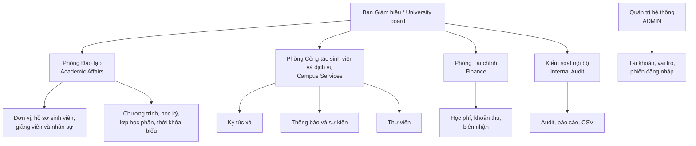
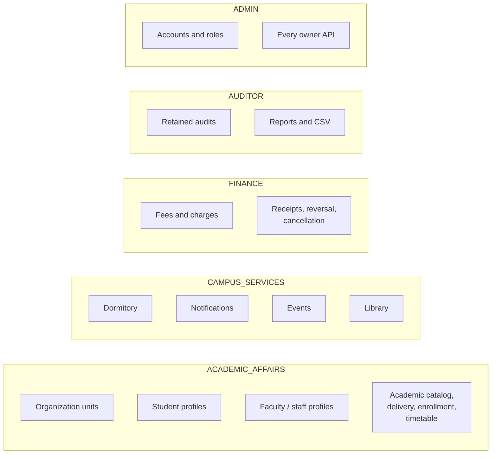
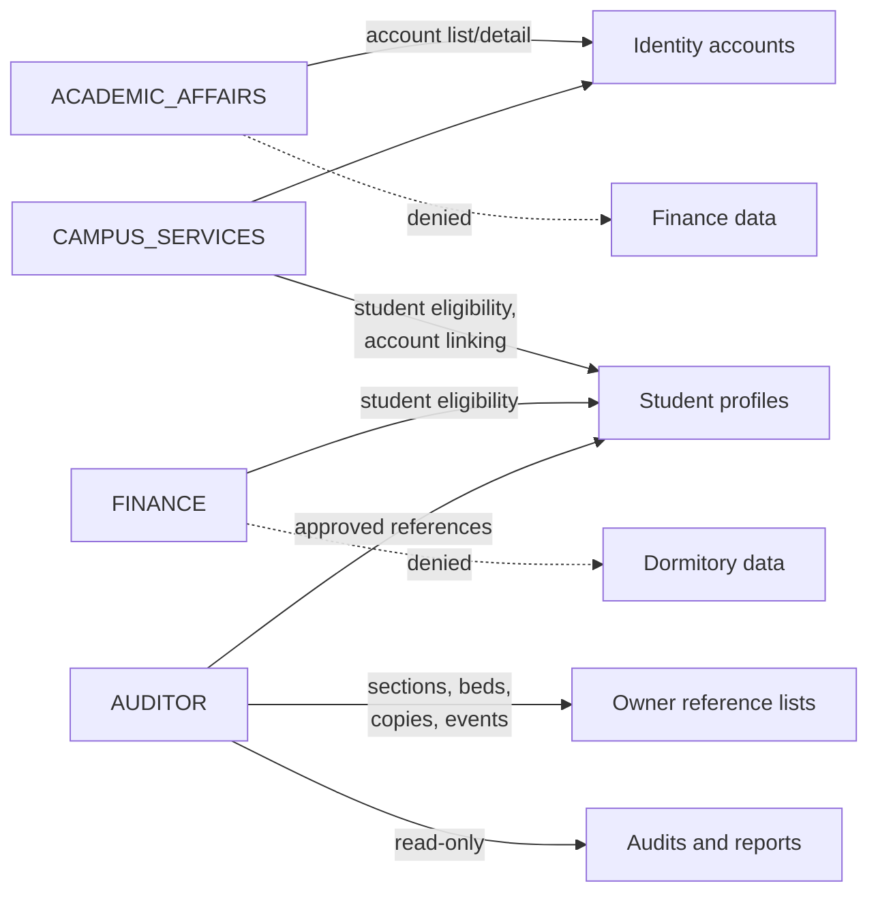
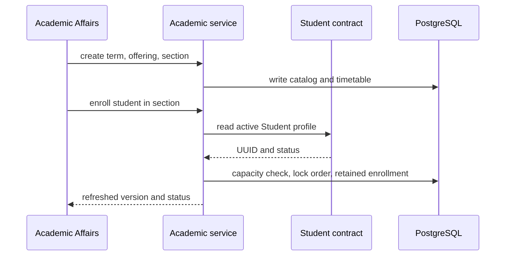
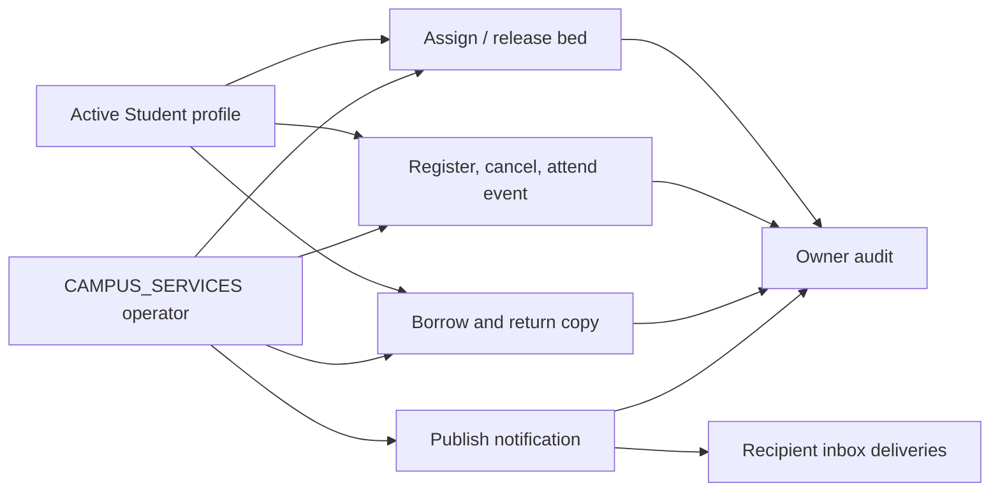
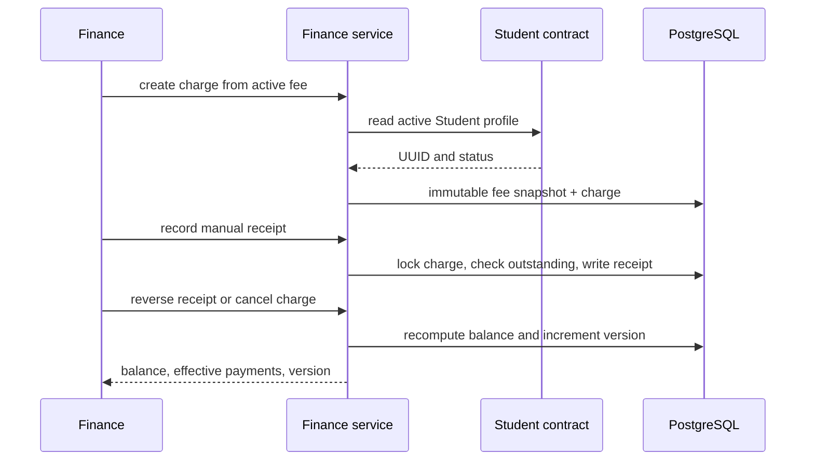
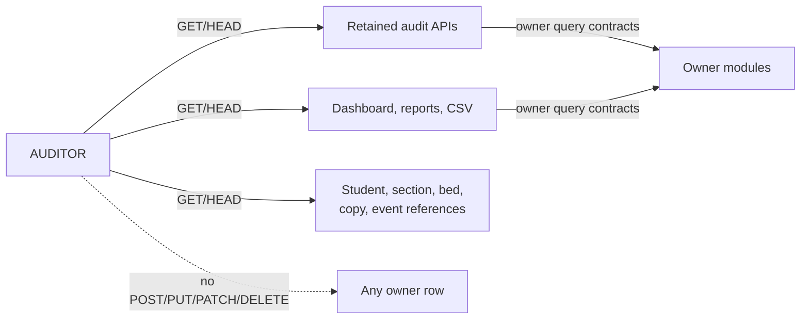
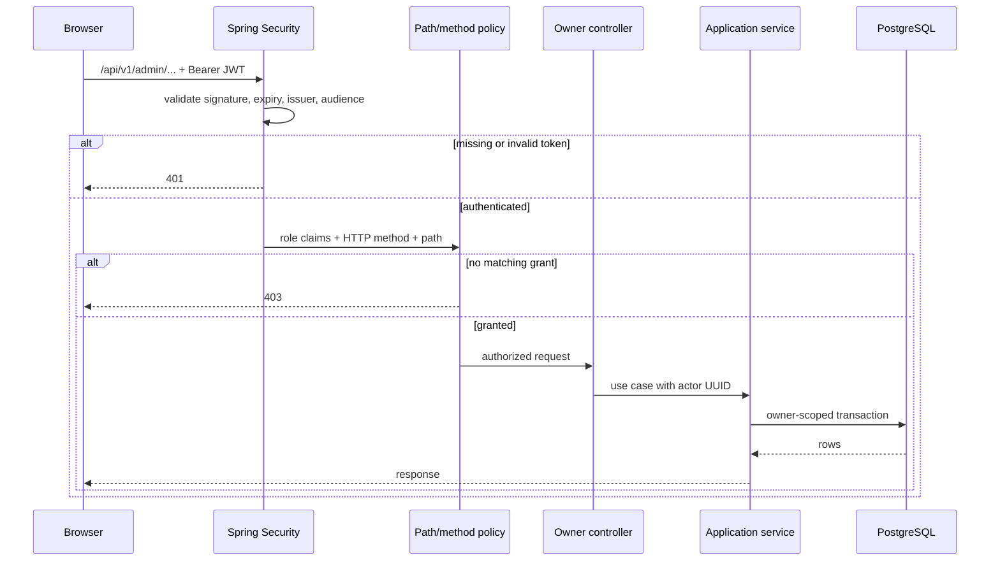

# Organization and data flow

This document describes how Campus Platform maps a university into departments, how each department maps to one role, and how data moves between owners. The role grants are authoritative in [Permissions](../permissions.md) and [ADR 0018](../decisions/0018-department-functional-roles.md).

## Campus organization

`ADMIN` is a platform function, not a fifth business department. It exists so accounts and roles can be provisioned and recovered; business staff receive a department role instead.

## Role to module ownership

A department owns every write in its boxes. It does not automatically own another department's box. Approved cross-reads are shown below; they are read-only.

## Cross-department reads

Denied arrows are deliberate: Finance cannot inspect dormitory stays, and Academic Affairs cannot post charges. A person who genuinely performs both jobs receives both roles.

## Data flows by department

### Academic affairs: profile to enrollment

The Student profile is owned by the Student module. Academic reads it through an application contract; it never imports Student tables. Withdrawal and restoration keep the same retained enrollment and re-check capacity.

### Campus services: accommodation, communication, events, library

Dormitory, Event and Library each ask the Student contract for fresh eligibility at decision time. Notification resolves active account UUIDs through Identity and writes one inbox delivery per recipient. Each owner writes its own audit row synchronously; the audit module only reads those rows later.

### Finance: charge to balance

Finance never writes Academic or Dormitory data automatically. Dormitory fees are manual charges; there is no scheduler or payment gateway.

### Internal audit and reporting: read-only evidence

Audit and reporting are read models over owner contracts. The auditor cannot mutate an owner row, read credentials, read loan circulations, read Event registrations or read notification deliveries.

## Request authorization flow

The JWT carries role codes as `ROLE_<CODE>` authorities. Grants are evaluated before controller validation, so a denied caller cannot probe payload errors. The UI mirrors the same matrix, but direct HTTP clients always meet the backend check.

## Related decisions

- [ADR 0001: Modular monolith](../decisions/0001-modular-monolith-first.md)
- [ADR 0003: Stateless access tokens](../decisions/0003-authentication-token-strategy.md)
- [ADR 0014: Owner-scoped audit viewing](../decisions/0014-owner-scoped-audit-viewing.md)
- [ADR 0015: Owner-scoped reporting](../decisions/0015-owner-scoped-current-state-reporting.md)
- [ADR 0018: Department-based roles](../decisions/0018-department-functional-roles.md)
